# Wizardry 8 — 4K borderless + HD interface (installer for the Steam version)

**English** | [Русский](README.md)

Wizardry 8 from Steam at your monitor's native resolution (for example 4K), borderless full screen, with sharp HD
text, an undistorted interface and wide HD backgrounds. One script installs everything, and one script removes it.

## Before and after

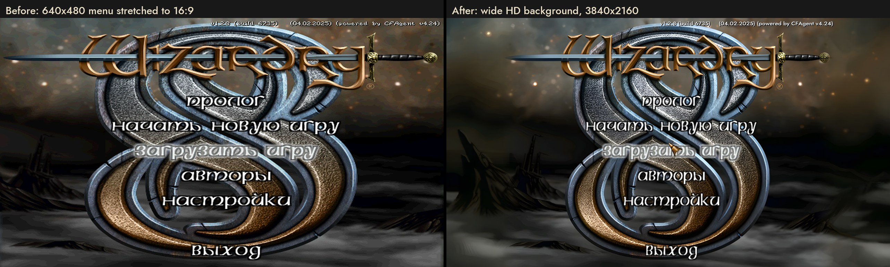

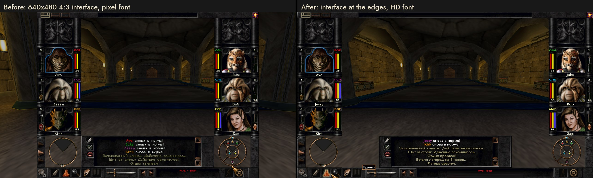

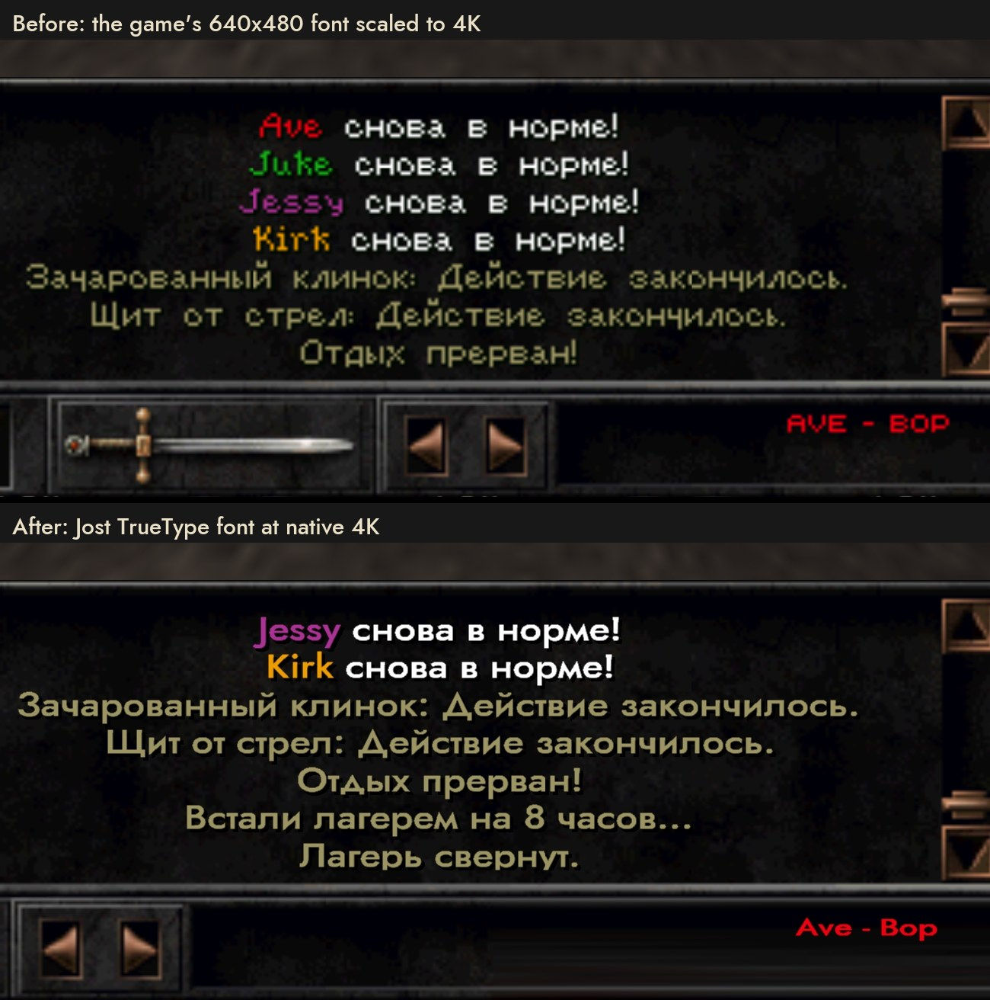

### More examples

Left: the game at 4K without the mod; right: with the mod. Same place, same party.

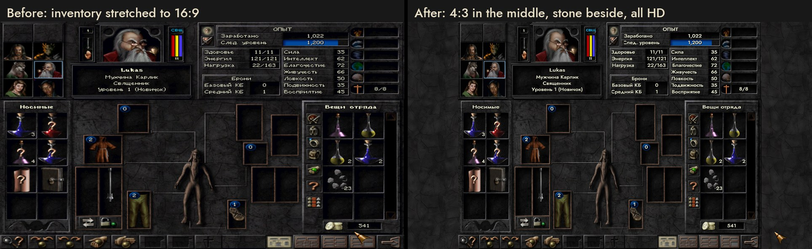

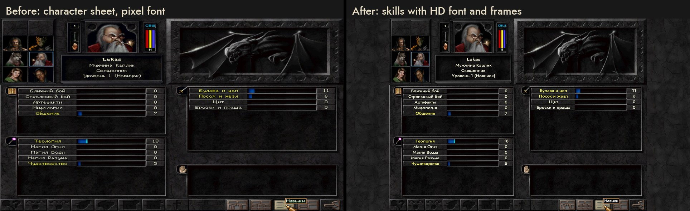

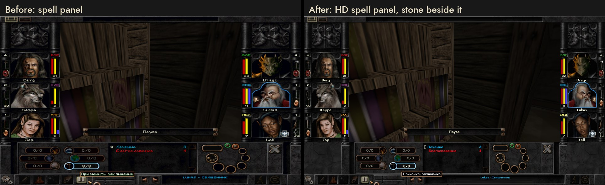

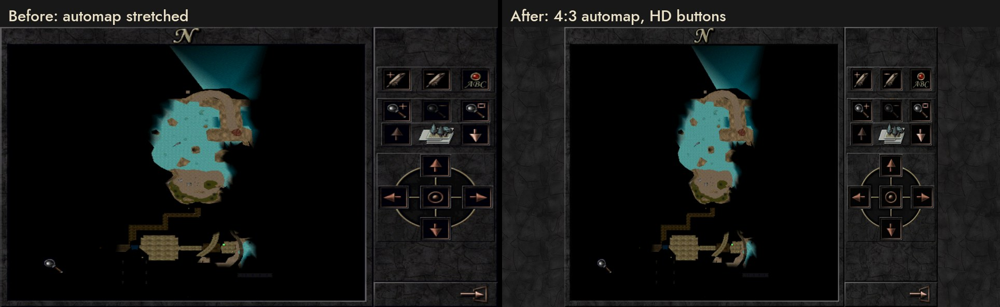

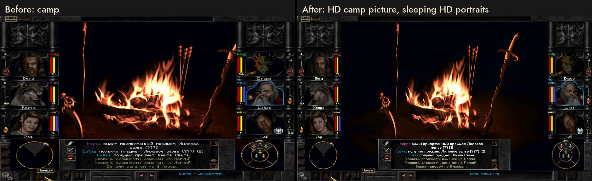

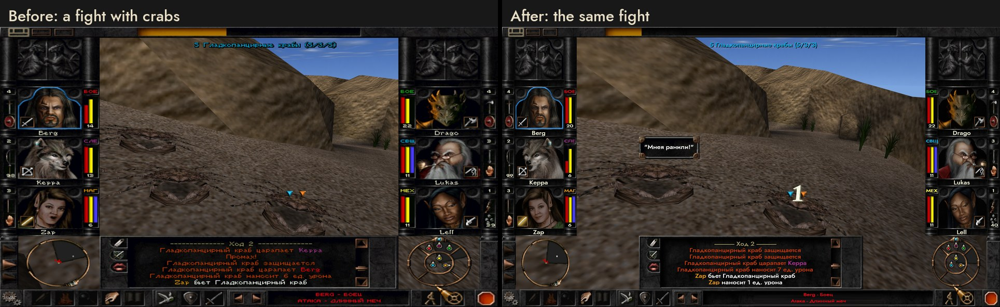

Close-ups, 4K pixels 1:1:

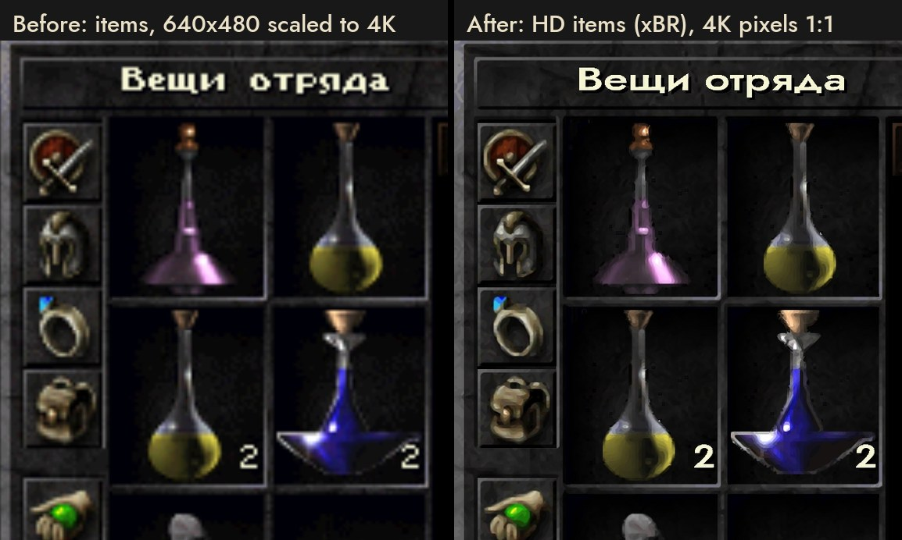

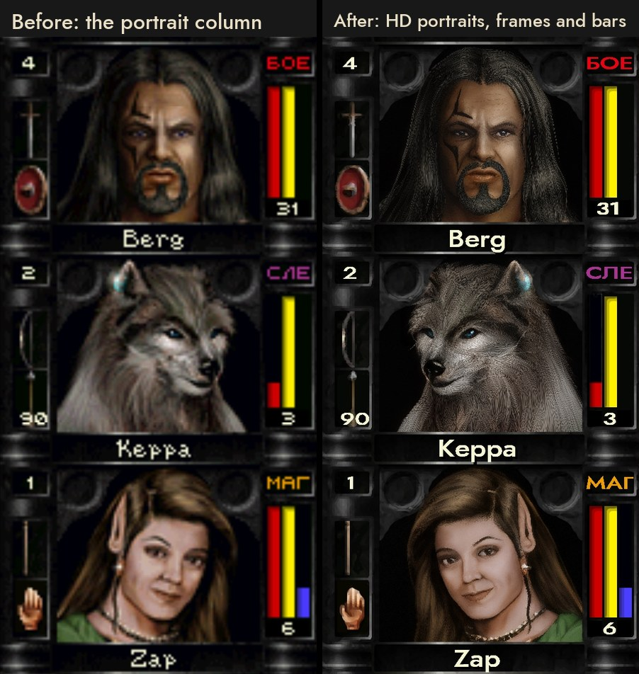

Menu captions (left: with the mod, but the captions still the game's own):

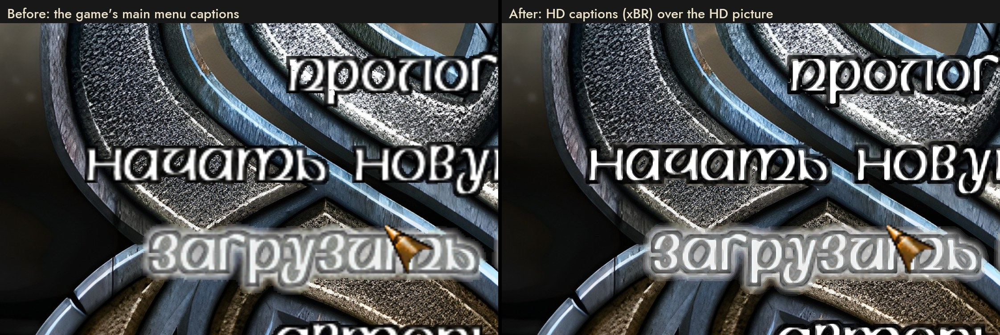

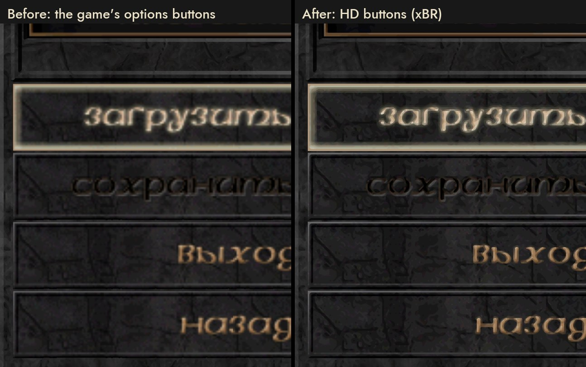

| | Steam version as is | After installing |
|---|---|---|
| Resolution | 800x600, 16-bit (Glide through nGlide) | your monitor's native resolution, 32-bit (DirectX through dgVoodoo2) |
| Screen | low-resolution full screen | borderless full screen, Alt+Tab without a monitor mode switch |
| Anti-aliasing | none | 8x MSAA, 16x anisotropic filtering |
| Interface | stretched to 16:9, portraits squashed | proportions kept, portraits and panels at the screen edges |
| Text | 640x480 pixel font, blurry | TrueType font at native resolution, tooltips included |
| Menu, loading and camp backgrounds | 640x480, stretched | wide 16:9 HD backgrounds |
| Character portraits | 640x480, blurry | HD in all three sizes, with blinking and talking |
| Frames, buttons, icons, items, spells, automap | 640x480, blurry | HD pictures (classic xBR pixel-art scaler, no AI) |
| Main menu captions, options and save/load buttons | 640x480, blurry | HD, in the game's language (Russian or English) |
| Inventory, party, character creation, spell panel | black bars or a stretched edge at the sides | the game's own stone at the sides, in HD |
| Location texts (diaries, signs) in the Russian version | in English | in Russian (Fan Patch texts) |
| 3dfx logo at startup | yes | no |

The "before" pictures are made from the game's own 640x480 interface frame: in the menu it is stretched to 16:9 the
way the game stretches it; on the game screen the interface is shown at 4:3. The in-game text is Russian because the
screenshots were taken with the Russian game language; the mod works with any language.

## What you need

- Windows 10 or 11, a Direct3D 11 graphics card, preferably a 16:9 monitor.
- Wizardry 8 from Steam.
- **Fan Patch 1.28**, an unofficial community patch. Steam does not include it; download it separately (step 2).
- **dgVoodoo2**. Steam does not include it either; the installer downloads it for you (step 4).
- An internet connection during installation and about 450 MB of disk space.

## Installation

1. **Install Wizardry 8 in Steam.**

2. **Download Fan Patch 1.28** and extract the archive into the game folder (`...\steamapps\common\Wizardry8`, where
   `Wiz8.exe` is), replacing files:
   - [GamePressure — Fan Patch v.1.2.8 Build 6709](https://www.gamepressure.com/download/wizardry-8-fan-patch-v128-build-6709-mod/z2152ee) (12.4 MB);
   - mirror: [ModHQ](https://mods.rpghq.org/wizardry-8/350301) (the site first checks that you are not a bot).

   Patch news and builds: the author's group [Cosmic Forge on VK](https://vk.com/club177350708).

3. **Run `Wiz8_v128.exe`** from the game folder, choose a language, press **Check for updates** in the patch's
   launcher and let it update. Then close the game.

4. **Download this installer**: **Code → Download ZIP** on this page, extract it anywhere and double-click
   `install.cmd`. The installer:
   - finds the game in your Steam libraries;
   - downloads [dgVoodoo2 2.87.5 from the official GitHub](https://github.com/dege-diosg/dgVoodoo2/releases/tag/v2.87.5)
     and checks its SHA-256 (author's site: [dege.freeweb.hu](http://dege.freeweb.hu/));
   - downloads the HD backgrounds and fonts (GitHub's ZIP has Git LFS stubs in their place) and checks their SHA-256;
   - sets the resolution, dgVoodoo2 and the HD interface, turns off the 3dfx logo and creates a desktop shortcut.

5. **Play through the "Wizardry 8 (Fan Patch 4K)" shortcut** on the desktop. Steam's Play button starts the
   original `Wiz8.exe` without the patch and the mod.

**Uninstall:** close the game and double-click `uninstall.cmd`. Every replaced file goes back as it was, added files
are deleted, and the shortcut and the nGlide setting are restored.

## Troubleshooting

| Message or symptom | What to do |
|---|---|
| `Wiz8_v128.exe (Fan Patch 1.28) not found` | Fan Patch is not extracted, see step 2 |
| `Wiz8_v128.exe has an unknown SHA-256` | you have a different patch exe. The mod works only with the exe from Fan Patch 1.28 (SHA-256 `fdca6d9c…a9fb824`); download the patch from the links in step 2 |
| `Wiz8.dll is a Fan Patch build this package was not checked with` | only a warning: tested with builds 6709 and 6735; a newer build most likely works too |
| `The game is running from this folder` | close the game and try again |
| antivirus flags `Wiz8_v128.exe` | the patch modifies the game in memory. The patch authors link a check of this exact file: [VirusTotal](https://www.virustotal.com/gui/file/fdca6d9cd0940034191e82b8e2900de26bb25e381c74128dcb8967360a9fb824/detection) |
| no internet | put [`dgVoodoo2_87_5.zip`](https://github.com/dege-diosg/dgVoodoo2/releases/download/v2.87.5/dgVoodoo2_87_5.zip) into `<game>\mods\`, get the installer with `git clone` (with Git LFS), then run `install.ps1 -Offline` |
| the game minimizes when you switch windows | that is how borderless full screen works; Alt+Tab back |
| stretched picture | the game was started with Steam's Play button, not the "Wizardry 8 (Fan Patch 4K)" shortcut |

## Installer options

From PowerShell: `powershell -ExecutionPolicy Bypass -File .\install.ps1 [options]`

| Option | What it does |
|---|---|
| `-GamePath "D:\...\Wizardry8"` | set the game folder by hand (not Steam, or not found) |
| `-Width 2560 -Height 1440` | a different resolution instead of the monitor's |
| `-DetectOnly` | only find the game and check versions and resolution |
| `-WhatIf` | show what would be done without changing anything |
| `-NoBackgrounds` | no HD backgrounds (−71 MB) |
| `-NoPortraits` | no HD portraits (−116 MB) |
| `-NoInterface` | no HD interface pictures or menu captions: frames, buttons, icons, items (−258 MB) |
| `-NoRusTexts` | keep the location texts in English in a Russian game |
| `-NoHdUi` | only the resolution and borderless screen, no HD interface |
| `-ResetConfig` | replace an existing `wiz8hd.ini` / `dgVoodoo.conf` with the defaults |
| `-NoShortcut`, `-SkipNGlide`, `-Offline` | no shortcut / no nGlide setting / no downloads |

Running it again updates the installation in place; your `wiz8hd.ini` and `dgVoodoo.conf` are kept. If the kept
`wiz8hd.ini` has `Sprites=0` (the default before the HD portraits), the installer warns: set `Sprites=1` or run
with `-ResetConfig`.

## What exactly changes

| What | Files |
|---|---|
| DirectX7_1 renderer at the monitor's resolution, 32-bit | `3DVideo.CFG` |
| Borderless screen, 8x MSAA, 16x anisotropic, no watermark | dgVoodoo2 2.87.5: `DDraw.dll`, `D3DImm.dll`, `dgVoodooCpl.exe`, `dgVoodoo.conf` |
| HD fonts (Jost), interface at the edges, HD tooltips | `wiz8hd.asi`, `wiz8hd.ini`, `wiz8hd_fonts\` |
| Wide HD backgrounds | `wiz8hd_bg\` (42 pictures 3840x2160 + 640x480 references for recognizing the screen) |
| Stone beside full-screen screens | `wiz8hd_bg\_sides.png` |
| HD portraits (982 frames: small, medium, large, blinking and talking) | `wiz8hd_ui\sti\PORTRAITS\` |
| HD interface pictures (4765 frames: frames, buttons, icons, items, spells, automap, character creation) | the other folders of `wiz8hd_ui\sti\` |
| HD menu captions (62 frames: main menu, options, save/load buttons) in the game's language: Russian when `Data\RUS.SLF` is there, English otherwise | `wiz8hd_ui\sti\OPTIONS\` (from `payload\wiz8hd_ui\captions\rus` or `eng`) |
| Russian location texts (only with `Data\RUS.SLF`): diaries, signs, bookshelves | `Data\Messages\*.MSG`, built from the Fan Patch's Russian texts in `Data\FanPatch.Dat` |
| No 3dfx logo | registry `HKCU\Software\Zeus Software\nGlide2`, `Splash=0` |
| Shortcut | "Wizardry 8 (Fan Patch 4K)" on the desktop → `Wiz8_v128.exe` |

Replaced files are saved in `<game>\_wiz8_4k\backup`, the list is in `_wiz8_4k\manifest.json`. Saves, `wiz8.ini`,
`Wiz8.CFG`, `Wiz8.exe` and the archives in `Data\` are not touched. No administrator rights needed.

Mod settings are in `wiz8hd.ini` in the game folder: `Aspect`, `Layout` (interface at the edges / 4:3 in the
centre), `Text` (TrueType fonts), `MatchWidth`, `Backgrounds` (HD backgrounds), `Sprites` (HD pictures), `Sides` (stone at the sides), `DrawDistance` (3D view distance, a multiple of the game's own; 2 by default), `Log`, and the `[Fonts]` section
(font and scale for each game font).

## How the mod works

`wiz8hd.asi` is the mod itself: an ordinary 32-bit Windows DLL (about 230 KB) named `.asi` instead of `.dll`.
Wizardry 8 has no mod loader of its own, but the Miles sound library that ships with the game loads every `*.asi`
in the game folder at startup. The mod comes in that way and hooks the functions it needs in the memory of
`Wiz8_v128.exe`; no game files are changed. It checks the exe and turns itself off for anything other than
Fan Patch 1.28.

In the game it:

- erases the letters the game draws with its bitmap fonts and draws the same text with Jost at full screen
  resolution (menus, the message log, dialogs, tooltips, Cyrillic included);
- keeps the 640x480 interface from being stretched on a wide screen: the portrait and bar panels move to the screen
  edges, and full-screen 2D screens (inventory, character sheet, level-up) stay 4:3 in the centre;
- replaces the menu, loading and camp pictures with wide HD versions from `wiz8hd_bg\`;
- with `Sprites=1`, replaces game pictures (STI frames) with HD versions from `wiz8hd_ui\sti\` when they exist.

What sits next to it in the game folder:

| File | What it is |
|---|---|
| `wiz8hd.ini` | mod settings |
| `wiz8hd.log` | the mod's log, for debugging (`Log=1`) |
| `wiz8hd_fonts\` | Jost fonts |
| `wiz8hd_bg\` | wide HD backgrounds |
| `wiz8hd_ui\sti\` | HD pictures (optional) |
| `wiz8hd.asi.prev*`, `wiz8hd.ini.prev` | backups of earlier versions if the mod was updated by hand; Miles does not load them, it only takes files ending exactly in `.asi` |

To remove the mod by hand, delete these files (or run `uninstall.cmd`); the game is back as it was.

## For developers

- `tests\Test-Roundtrip.ps1 -Source "<game folder>"` checks the installer on small copies of the game folder in
  `tests\_work`: `-WhatIf` changes nothing, installing puts the right files, a second install keeps the backups and
  the ini, uninstalling restores the folder byte for byte, an unknown exe and a missing Fan Patch are refused. It does
  not start the game and writes only to a test registry key; at the end it checks that the real nGlide key and the
  shortcut are unchanged.
- `tests\Build-CleanSteamCopy.ps1` builds a copy of the game in a separate folder from a list of files with hashes,
  to test in game without risk to the main install. Tested this way on 2026-10-24 (Fan Patch 6709, 3840x2160):
  menu, world, byte-for-byte uninstall.
- `tools\Update-Payload.ps1` refreshes `payload\` after rebuilding the mod (`wizardry8-hdui`: `./build.sh`,
  `build\wiz8hd.asi` → `dist\`). Pictures and fonts are stored in Git LFS.
- `tools\make_compare.py <wizardry8-hdui>\shots` builds the before/after pictures in `docs\` (Russian and English);
  the `ex_off_*` / `ex_on_*` shots come from `tools/shoot_examples.sh off|on` in `wizardry8-hdui`.

## Licenses and origin

- Jost — SIL Open Font License (`payload\wiz8hd_fonts\Jost-LICENSE.txt`).
- dgVoodoo2 — © Dege; not in this repository, downloaded from the official GitHub.
- Fan Patch 1.28 — GreatMage and the Cosmic Forge community; not in this repository, downloaded separately.
- HD backgrounds — upscaled (Real-ESRGAN) and outpainted (SDXL inpainting) versions of the game's original pictures;
  the `.raw` files are copies of the original 640x480 backgrounds the mod uses to recognize the screen. The rights to
  the original pictures belong to the Wizardry 8 rights holder; the backgrounds are published as a fan modification
  for owners of the game and will be removed at the rights holder's first request. Without them: `-NoBackgrounds`.
- HD portraits: the game's own portraits, upscaled (4xNomos8kDAT, then SUPIR) without painting in new details; shared
  on the same terms. Without them: `-NoPortraits`.
- HD interface pictures: the game's own pictures, upscaled with the classic pixel-art scaler xBR (an ffmpeg filter,
  no neural networks); the dark edge they were anti-aliased with against black is partly turned into
  transparency. Shared on the same terms. Without them: `-NoInterface`. The pictures with words on them (main menu,
  options buttons) are made separately from the Russian (`RUS.SLF`) and English (`DATA.SLF`) originals; the main
  menu captions are cut out of their old 640x480 background, so the wide HD picture shows under them.
- `wiz8hd.asi` — the built mod; its source is in a separate repository, `wizardry8-hdui` (not published yet).
- Wizardry 8 was developed by Sir-Tech Canada; Wizardry is a trademark of its rights holder. This project is not
  affiliated with the rights holder, Steam or the Fan Patch authors.
