# Wizardry 8 — 4K без рамок + HD-интерфейс (установщик для Steam-версии)

**English version: [README.en.md](README.en.md)** | Русский

Wizardry 8 из Steam в родном разрешении монитора (например 4K), на весь экран без рамок, с чётким HD-текстом,
интерфейсом без растяжения и широкими HD-фонами. Всё ставится одним скриптом и так же одним скриптом убирается.

## До и после

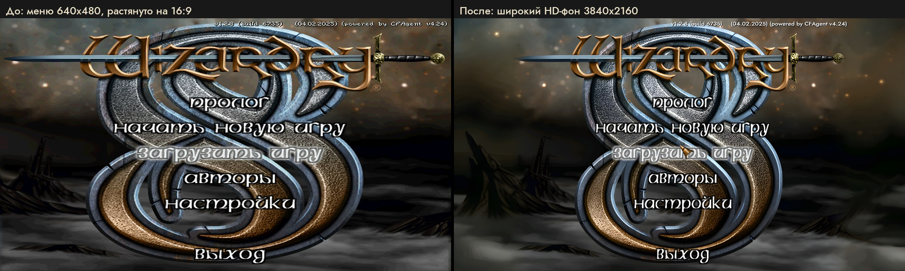

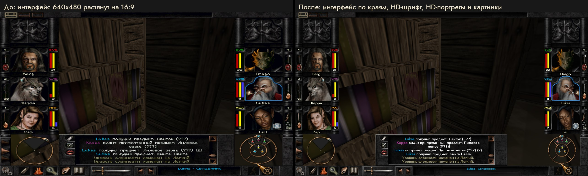

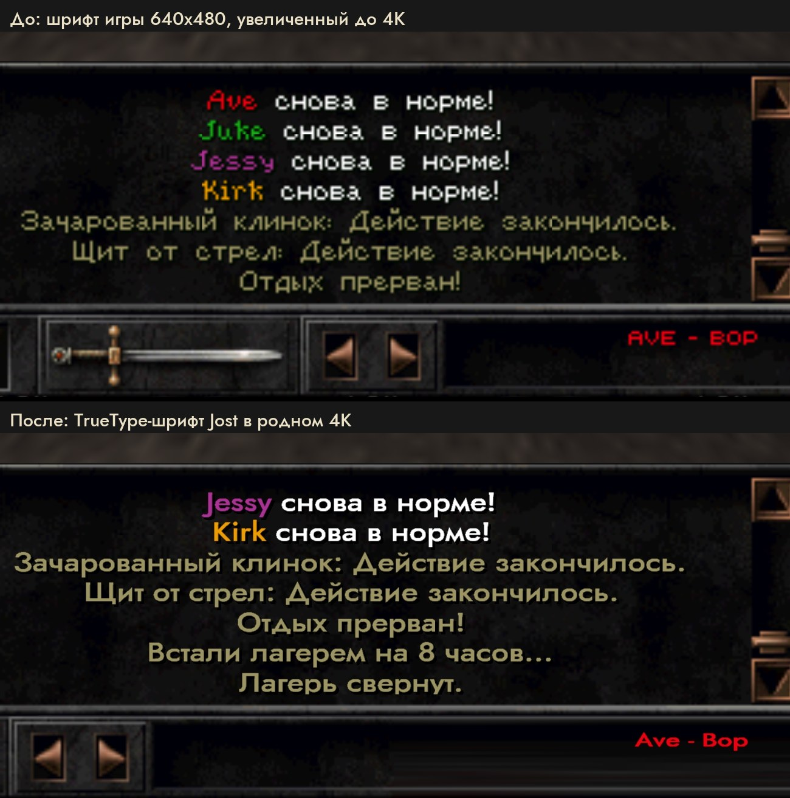

### Больше примеров

Слева игра в 4K без мода, справа с модом: та же сцена, тот же отряд.

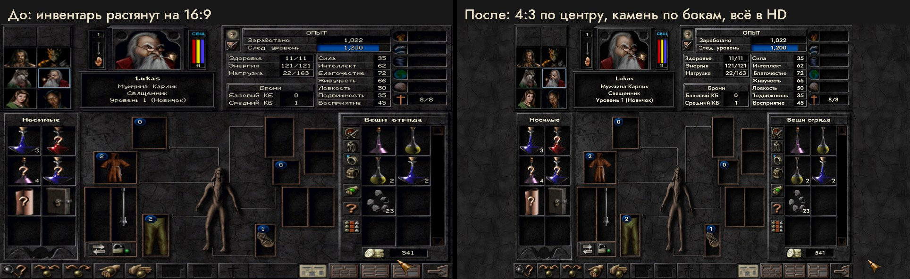

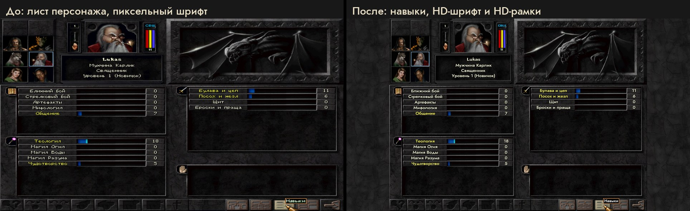

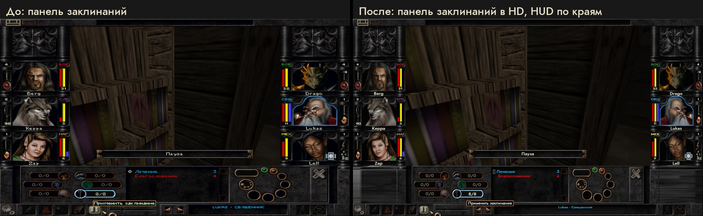

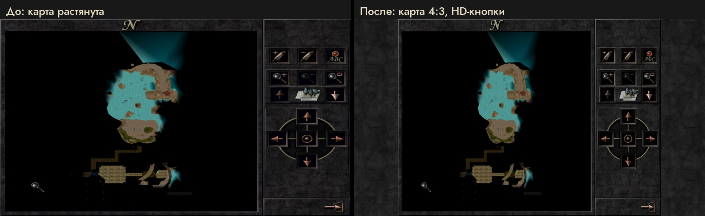

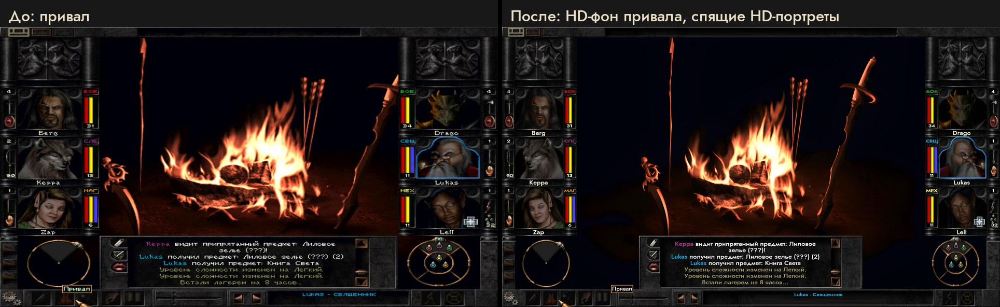

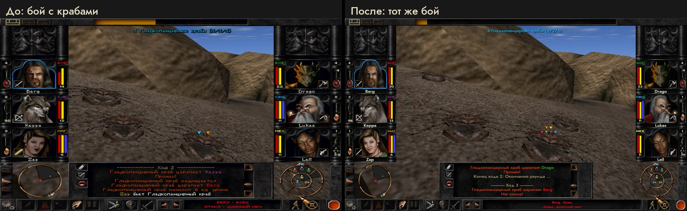

Крупно, пиксели 4K 1:1:

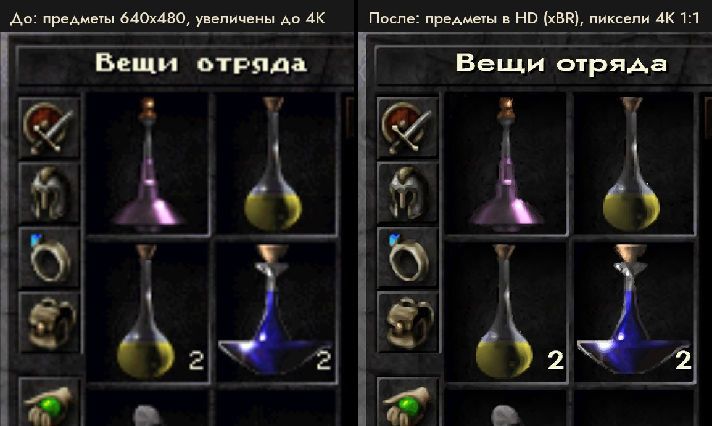

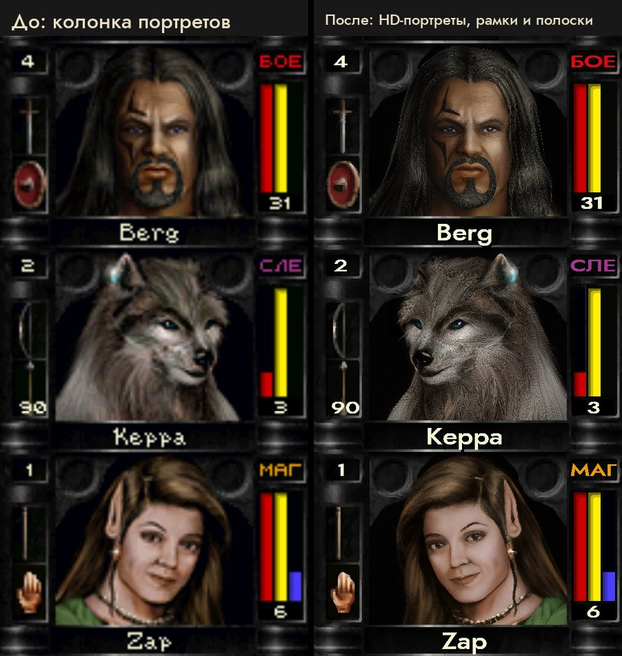

Надписи меню (слева — с модом, но надписи ещё из игры):

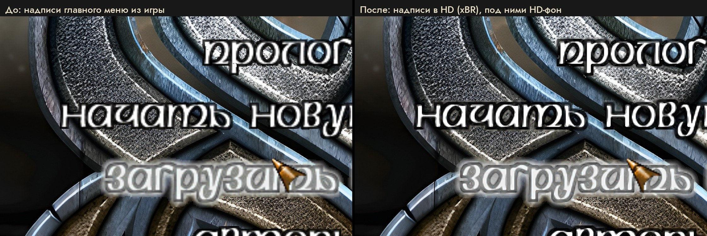

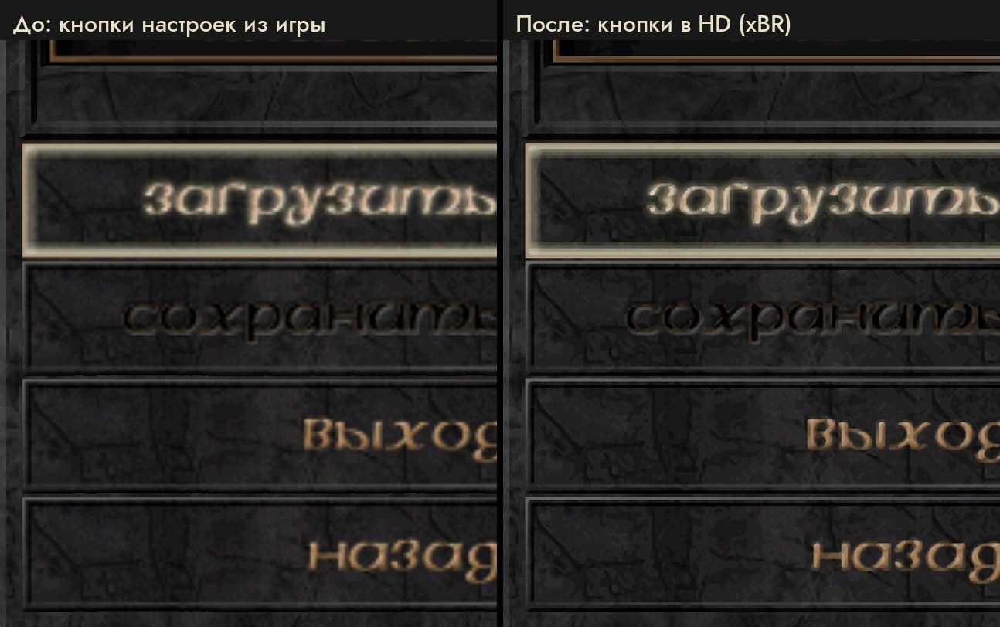

| | Steam-версия как есть | После установки |
|---|---|---|
| Разрешение | 800x600, 16 бит (Glide через nGlide) | родное разрешение монитора, 32 бит (DirectX через dgVoodoo2) |
| Экран | полный экран с низким разрешением | весь экран без рамок, Alt+Tab без смены режима монитора |
| Сглаживание | нет | 8x MSAA, 16x анизотропная фильтрация |
| Интерфейс | растянут на 16:9, портреты сплюснуты | пропорции сохранены, портреты и панели по краям экрана |
| Текст | пиксельный шрифт 640x480, размыт | TrueType-шрифт в родном разрешении, включая подсказки |
| Фоны меню, загрузки, привала | 640x480, растянуты | широкие HD-фоны 16:9 |
| Портреты персонажей | 640x480, размыты | HD во всех трёх размерах, с морганием и речью |
| Рамки, кнопки, иконки, предметы, заклинания, карта | 640x480, размыты | HD-картинки (классический апскейлер xBR, без AI) |
| Надписи главного меню, кнопки настроек, сохранения и загрузки | 640x480, размыты | в HD, на языке игры (русские или английские) |
| Инвентарь, отряд, создание персонажа, панель заклинаний | чёрные полосы или растянутый край по бокам | по бокам камень из самой игры в HD |
| Тексты локаций (дневники, надписи) в русской версии | по-английски | по-русски (тексты из Fan Patch) |
| Логотип 3dfx при запуске | есть | нет |

Картинки «до» сняты с исходного кадра интерфейса 640x480: в меню он растянут на 16:9 так же, как его растягивает
игра; на игровом экране интерфейс показан в пропорциях 4:3.

## Что нужно

- Windows 10 или 11, видеокарта с Direct3D 11, лучше монитор 16:9.
- Wizardry 8 из Steam.
- **Fan Patch 1.28** — неофициальный патч, в Steam его нет, скачивается отдельно (шаг 2).
- **dgVoodoo2** — в Steam его тоже нет; он лежит в архиве релиза (или установщик скачает его сам).
- Около 450 МБ на диске, с HD-текстурами 3D-мира — ещё около 2,9 ГБ.

## Установка

1. **Установить Wizardry 8 в Steam.**

2. **Скачать Fan Patch 1.28** и распаковать архив в папку игры (`...\steamapps\common\Wizardry8`, там, где
   `Wiz8.exe`), заменяя файлы:
   - [GamePressure — Fan Patch v.1.2.8 Build 6709](https://www.gamepressure.com/download/wizardry-8-fan-patch-v128-build-6709-mod/z2152ee) (12.4 МБ);
   - запасной вариант: [ModHQ](https://mods.rpghq.org/wizardry-8/350301) (сайт сначала проверяет, что вы не бот).

   Новости и сборки патча — в группе автора [Cosmic Forge во ВКонтакте](https://vk.com/club177350708).

3. **Запустить `Wiz8_v128.exe`** из папки игры, выбрать язык, в лаунчере патча нажать **«Проверить обновления»**
   (Check for updates) и дать ему обновиться. Потом закрыть игру.

4. **Скачать установщик со страницы [релизов](https://github.com/itaskaev2/wizardry8-4k/releases/latest)**:
   - `Wizardry8-4K-<версия>.zip` — установщик, HD-интерфейс и dgVoodoo2 (около 450 МБ);
   - `Wizardry8-4K-<версия>-textures.zip` — HD-текстуры 3D-мира: стены, земля, монстры, предметы (около 1,9 ГБ,
     по желанию).

   Распаковать оба архива в одну папку (получится одна папка `Wizardry8-4K` с `textures\` внутри) и дважды
   щёлкнуть `install.cmd`. Интернет не нужен: всё уже в архивах. Можно и без релиза — кнопка
   **Code → Download ZIP** на этой странице: тогда установщик сам скачает dgVoodoo2 и картинки, но без HD-текстур.
   Установщик сам:
   - найдёт игру в библиотеках Steam;
   - возьмёт dgVoodoo2 из архива или скачает [dgVoodoo2 2.87.5 с официального GitHub](https://github.com/dege-diosg/dgVoodoo2/releases/tag/v2.87.5)
     и сверит его SHA-256 (сайт автора: [dege.freeweb.hu](http://dege.freeweb.hu/));
   - докачает HD-фоны и шрифты (в ZIP с GitHub вместо них лежат ссылки Git LFS) и сверит их SHA-256;
   - настроит разрешение, dgVoodoo2, HD-интерфейс, выключит логотип 3dfx и создаст ярлык на рабочем столе;
   - положит HD-текстуры 3D-мира, если рядом есть папка `textures\` из второго архива;
   - включит у `Wiz8_v128.exe` флаг Large Address Aware: игре станет доступно 4 ГБ памяти вместо 2 (с HD-текстурами
     3D-мира большие локации вроде Арники упирались в 2 ГБ и вылетали). Это один бит в заголовке exe, оригинал
     сохраняется в резервной копии; проверка файлов в Steam вернёт старый exe, тогда запустите установщик ещё раз.

5. **Играть через ярлык «Wizardry 8 (Fan Patch 4K)»** на рабочем столе. Кнопка «Играть» в Steam запускает
   оригинальный `Wiz8.exe` без патча и мода.

**Удалить:** закрыть игру и дважды щёлкнуть `uninstall.cmd`. Все заменённые файлы вернутся как были, добавленные
удалятся, ярлык и настройка nGlide восстановятся.

## Если что-то не так

| Сообщение или симптом | Что делать |
|---|---|
| `Wiz8_v128.exe (Fan Patch 1.28) not found` | не распакован Fan Patch, см. шаг 2 |
| `Wiz8_v128.exe has an unknown SHA-256` | у вас другой exe патча. Мод работает только с exe из Fan Patch 1.28 (SHA-256 `fdca6d9c…a9fb824`); скачайте патч по ссылкам из шага 2 |
| `Wiz8.dll is a Fan Patch build this package was not checked with` | только предупреждение: проверено на сборках 6709 и 6735, с более новой мод скорее всего тоже работает |
| `The game is running from this folder` | закройте игру и повторите |
| антивирус ругается на `Wiz8_v128.exe` | патч правит игру в памяти. Авторы патча сами дают проверку этого файла: [VirusTotal](https://www.virustotal.com/gui/file/fdca6d9cd0940034191e82b8e2900de26bb25e381c74128dcb8967360a9fb824/detection) |
| нет интернета | положите [`dgVoodoo2_87_5.zip`](https://github.com/dege-diosg/dgVoodoo2/releases/download/v2.87.5/dgVoodoo2_87_5.zip) в `<игра>\mods\` и скачайте установщик через `git clone` (с Git LFS), затем `install.ps1 -Offline` |
| игра сворачивается при переключении окон | так работает полноэкранный режим без рамок, вернуться — Alt+Tab |
| растянутая картинка | игра запущена кнопкой Steam, а не ярлыком «Wizardry 8 (Fan Patch 4K)» |

## Параметры установщика

Из PowerShell: `powershell -ExecutionPolicy Bypass -File .\install.ps1 [ключи]`

| Ключ | Что делает |
|---|---|
| `-GamePath "D:\...\Wizardry8"` | указать папку игры вручную (не Steam или не нашлась) |
| `-Width 2560 -Height 1440` | другое разрешение вместо разрешения монитора |
| `-DetectOnly` | только найти игру, проверить версии и разрешение |
| `-WhatIf` | показать, что будет сделано, ничего не меняя |
| `-NoBackgrounds` | без HD-фонов (−71 МБ) |
| `-NoPortraits` | без HD-портретов (−116 МБ) |
| `-NoInterface` | без HD-картинок интерфейса и надписей меню: рамок, кнопок, иконок, предметов (−258 МБ) |
| `-NoRusTexts` | оставить тексты локаций по-английски в русской версии |
| `-NoTextures` | не ставить HD-текстуры 3D-мира, даже если папка `textures\` рядом |
| `-NoHdUi` | только разрешение и экран без рамок, без HD-интерфейса |
| `-ResetConfig` | заменить уже существующие `wiz8hd.ini` / `dgVoodoo.conf` настройками по умолчанию |
| `-NoShortcut`, `-SkipNGlide`, `-Offline` | без ярлыка / без настройки nGlide / ничего не скачивать |
| `-NoLargeAddress` | не ставить флаг 4 ГБ, оставить `Wiz8_v128.exe` как есть |

Повторный запуск обновляет установку на месте; ваши `wiz8hd.ini` и `dgVoodoo.conf` сохраняются. Если в
сохранённом `wiz8hd.ini` стоит `Sprites=0` (так было до HD-портретов), установщик предупредит: поставьте
`Sprites=1` или запустите с `-ResetConfig`.

## Что именно меняется

| Что | Файлы |
|---|---|
| Рендер DirectX7_1 в разрешении монитора, 32 бит | `3DVideo.CFG` |
| Экран без рамок, 8x MSAA, 16x анизотропия, без водяных знаков | dgVoodoo2 2.87.5: `DDraw.dll`, `D3DImm.dll`, `dgVoodooCpl.exe`, `dgVoodoo.conf` |
| HD-шрифты (Jost), интерфейс по краям, HD-подсказки | `wiz8hd.asi`, `wiz8hd.ini`, `wiz8hd_fonts\` |
| Широкие HD-фоны | `wiz8hd_bg\` (42 картинки 3840x2160 + эталоны 640x480 для распознавания экрана) |
| Камень по бокам полноэкранных экранов | `wiz8hd_bg\_sides.png` |
| HD-портреты (982 кадра: маленькие, средние, большие, моргание и речь) | `wiz8hd_ui\sti\PORTRAITS\` |
| HD-картинки интерфейса (4765 кадров: рамки, кнопки, иконки, предметы, заклинания, карта, создание персонажа) | остальные папки `wiz8hd_ui\sti\` |
| HD-надписи меню (62 кадра: главное меню, кнопки настроек, сохранения и загрузки) на языке игры: русские, если есть `Data\RUS.SLF`, иначе английские | `wiz8hd_ui\sti\OPTIONS\` (из `payload\wiz8hd_ui\captions\rus` или `eng`) |
| Русские тексты локаций (только если есть `Data\RUS.SLF`): дневники, надписи, полки | `Data\Messages\*.MSG`, собираются из русских текстов Fan Patch в `Data\FanPatch.Dat` |
| HD-текстуры 3D-мира (6948: стены, земля, монстры, предметы на земле; мелкие в 4x, 256 px в 2x) — если распакован второй архив | отдельные `*.TGA` в `Levels\<локация>\BITMAPS\`, `Data\Monsters\BITMAPS\`, `Data\ITEMS3D\bitmaps\`: игра берёт их вместо записей в `LEVELS.SLF` / `MONSTERS.SLF` / `DATA.SLF` |
| 4 ГБ памяти для игры вместо 2 | флаг Large Address Aware в заголовке `Wiz8_v128.exe` (оригинал в бэкапе) |
| Без логотипа 3dfx | реестр `HKCU\Software\Zeus Software\nGlide2`, `Splash=0` |
| Ярлык | «Wizardry 8 (Fan Patch 4K)» на рабочем столе → `Wiz8_v128.exe` |

Заменённые файлы сохраняются в `<игра>\_wiz8_4k\backup`, список — в `_wiz8_4k\manifest.json`. Сохранения,
`wiz8.ini`, `Wiz8.CFG`, `Wiz8.exe` и архивы в `Data\` не трогаются. Права администратора не нужны.

Настройки мода — `wiz8hd.ini` в папке игры: `Aspect`, `Layout` (интерфейс по краям / 4:3 в центре), `Text`
(TrueType-шрифты), `MatchWidth`, `Backgrounds` (HD-фоны), `Sprites` (HD-картинки), `Sides` (камень по бокам), `DrawDistance` (дальность прорисовки 3D-мира, множитель к родной; по умолчанию 2), `Log`, секция `[Fonts]` (шрифт и масштаб для каждого
игрового шрифта).

## Как работает мод

`wiz8hd.asi` — это сам мод: обычная 32-битная Windows DLL (около 230 КБ) с расширением `.asi` вместо `.dll`.
Своего загрузчика модов у Wizardry 8 нет, но звуковая библиотека Miles, которая идёт с игрой, при запуске сама
загружает все `*.asi` из папки игры. Мод подхватывается вместе с ней и перехватывает нужные функции прямо в памяти
`Wiz8_v128.exe`; сам мод файлы игры не меняет (флаг 4 ГБ у exe ставит установщик). Мод проверяет exe и с любой другой версией, кроме Fan Patch 1.28,
выключается сам.

Внутри игры он:

- стирает буквы, которые игра рисует растровыми шрифтами, и рисует тот же текст шрифтом Jost в полном разрешении
  экрана (меню, журнал сообщений, диалоги, подсказки, кириллица тоже);
- не растягивает интерфейс 640x480 на широкий экран: панели с портретами и полосками уезжают к краям экрана,
  полноэкранные 2D-экраны (инвентарь, лист персонажа, повышение уровня) остаются 4:3 в центре;
- подменяет фоны меню, загрузки и лагеря на широкие HD-версии из `wiz8hd_bg\`;
- при `Sprites=1` подменяет картинки игры (кадры STI) на HD-версии из `wiz8hd_ui\sti\`, если они там есть.

Что лежит рядом с ним в папке игры:

| Файл | Что это |
|---|---|
| `wiz8hd.ini` | настройки мода |
| `wiz8hd.log` | журнал работы мода, для отладки (`Log=1`) |
| `wiz8hd_fonts\` | шрифты Jost |
| `wiz8hd_bg\` | широкие HD-фоны |
| `wiz8hd_ui\sti\` | HD-картинки (необязательно) |
| `wiz8hd.asi.prev*`, `wiz8hd.ini.prev` | бэкапы прошлых версий, если мод обновляли вручную; Miles их не грузит — он берёт только файлы, оканчивающиеся ровно на `.asi` |

Удалить мод вручную — удалить эти файлы (или `uninstall.cmd`), игра станет как была.

## Для разработчиков

- `tests\Test-Roundtrip.ps1 -Source "<папка игры>"` — проверка на маленьких копиях папки игры в `tests\_work`:
  `-WhatIf` ничего не меняет, установка кладёт правильные файлы, повторная не трогает бэкапы и ini, откат возвращает
  папку байт в байт, неизвестный exe и отсутствие Fan Patch — отказ. Игру не запускает, пишет только в тестовый
  ключ реестра; в конце проверяет, что настоящий ключ nGlide и ярлык не изменились.
- `tests\Build-CleanSteamCopy.ps1` — собирает копию игры в отдельную папку по списку файлов с хешами, для проверки
  в игре без риска для основной установки. Так проверено 2026-10-24 (Fan Patch 6709, 3840x2160): меню, мир,
  откат байт в байт.
- `tools\Build-Release.ps1 -Version <v> -Out <папка>` — собрать два архива релиза (установщик с payload и
  dgVoodoo2; HD-текстуры из `wizardry8-hdui` `tools\tex_hd.py`) и `SHA256SUMS.txt`; потом `gh release create`.
- `tools\Update-Payload.ps1` — обновить `payload\` после пересборки мода (`wizardry8-hdui`: `./build.sh`,
  `build\wiz8hd.asi` → `dist\`). Картинки и шрифты хранятся в Git LFS.
- `tools\make_compare.py <wizardry8-hdui>\shots` — собрать картинки «до/после» в `docs\` (русские и английские);
  снимки `ex_off_*` / `ex_on_*` делает `tools/shoot_examples.sh off|on` в `wizardry8-hdui`.

## Лицензии и происхождение

- Jost — SIL Open Font License (`payload\wiz8hd_fonts\Jost-LICENSE.txt`).
- dgVoodoo2 — © Dege; в репозитории его нет. В архив релиза положен оригинальный неизменённый
  `dgVoodoo2_87_5.zip`: автор разрешает поставлять его компоненты вместе с модом к игре.
- Fan Patch 1.28 — GreatMage и сообщество Cosmic Forge; в репозитории его нет, скачивается отдельно.
- HD-фоны — апскейл (Real-ESRGAN) и дорисовка краёв (SDXL inpainting) оригинальных картинок игры, `.raw` — копии
  оригинальных фонов 640x480, по которым мод узнаёт экран. Права на исходные картинки принадлежат правообладателю
  Wizardry 8; фоны выложены как фанатская модификация для владельцев игры и будут убраны по первому запросу
  правообладателя. Без них: `-NoBackgrounds`.
- HD-портреты — те же оригинальные портреты, увеличенные (4xNomos8kDAT, затем SUPIR) без дорисовки новых деталей;
  выложены на тех же условиях. Без них: `-NoPortraits`.
- HD-картинки интерфейса — оригинальные картинки игры, увеличенные классическим апскейлером для пиксель-арта xBR
  (фильтр ffmpeg, без нейросетей); тёмный край, сглаженный по чёрному фону, частично переведён в прозрачность.
  Выложены на тех же условиях. Без них: `-NoInterface`. Картинки с надписями (главное меню, кнопки настроек)
  сделаны отдельно из русских (`RUS.SLF`) и английских (`DATA.SLF`) оригиналов; у надписей главного меню вырезан
  старый фон 640x480, чтобы под ними был виден широкий HD-фон.
- HD-текстуры 3D-мира — оригинальные текстуры игры, увеличенные в 4 раза (4xNomos8kDAT) без дорисовки новых
  деталей; текстуры 256 px уменьшены до 2x, чтобы игра укладывалась в память. Выложены на тех же условиях,
  отдельным архивом релиза. Без них: не скачивать этот архив или `-NoTextures`.
- `wiz8hd.asi` — собранный мод; его исходники лежат в отдельном репозитории `wizardry8-hdui` (пока не опубликован).
- Wizardry 8 разработана Sir-Tech Canada; Wizardry — торговая марка её правообладателя. Проект не связан с
  правообладателем, Steam или авторами Fan Patch.
